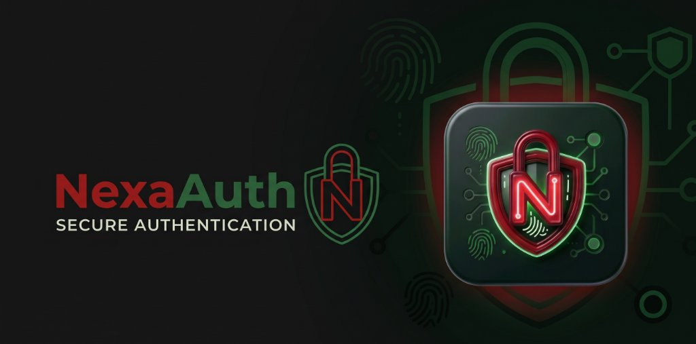

# 🛡️ NexaAuth - Next-Gen 2FA & Secure Authenticator

<p align="center">
  
</p>

<p align="center">
  <b>Military-grade, offline-first Two-Factor Authentication (2FA/TOTP) mobile application built with React, TypeScript, Tailwind CSS, and Capacitor.</b>
</p>

---

## ⚡ Highlights & Key Features

- **🔐 RFC 6238 TOTP Standard**: 100% offline generation of rotating 6-digit authentication codes with a 30-second live countdown ring and urgent alert animations.
- **✨ Animated Cyber Security Welcome**: Neon cyber aesthetics with pulsed radar rings, laser sweep lines, and encrypted status indicators.
- **📱 Dual Authentication Onboarding**:
  - **Google OAuth 2.0**: 1-tap sign-in with automatic email verification.
  - **Mobile Phone SMS OTP**: Responsive 6-digit code entry with auto-focus and auto-paste support.
- **👤 Advanced Profile & Security Center**:
  - Verified badges (`Email Verified` & `Phone Verified`).
  - **Enter Email & Verify**: In-app OTP flow to link and verify email.
  - **Enter Phone & Verify**: In-app SMS OTP flow to link and verify phone number.
  - **Custom Profile Picture**: Upload image from device camera/gallery or choose from 6 cyber avatar presets.
  - Real-time Vault Protection Security Meter (up to 100% MAXIMUM).
- **👑 Subscription Plans (Pro & Enterprise)**:
  - Monthly vs Annual billing toggle with 40% discount badge.
  - Interactive payment checkout simulator (UPI, Google Pay, Credit/Debit card).
  - Unlocks unlimited accounts, AES-256 cloud backup, and multi-device sync.
- **🔒 Biometric Shield & PIN Lock**:
  - Interactive press-and-hold fingerprint sensor with radial progress fill.
  - 4-digit PIN fallback keypad for instant vault decryption.
- **📸 QR Code Scanner & Manual Entry**:
  - Live viewfinder simulator with animated cyber laser scanner.
  - Quick presets for popular services (Google, GitHub, Binance, Discord, Cloudflare, etc.).
- **📂 Categorized Vault Management**:
  - Search filter and category pills (All, Work, Crypto, Personal, Social).
  - 1-tap clipboard copy with checkmark feedback & confetti.
  - Show/Hide tokens toggle for shoulder-surfing protection.
- **📲 Native Android Ready**: Built and wrapped with **Capacitor 7** with custom high-res mipmap launcher icons and safe-area notch support.

---

## 🛠️ Tech Stack

- **Framework**: [React 18](https://react.dev/) + [Vite 6](https://vitejs.dev/) + [TypeScript](https://www.typescriptlang.org/)
- **Mobile Runtime**: [Capacitor 7](https://capacitorjs.com/) for native Android
- **Styling**: [Tailwind CSS v4](https://tailwindcss.com/)
- **Animations**: [Framer Motion](https://www.framer.com/motion/)
- **Icons**: [Lucide React](https://lucide.dev/)
- **Visual FX**: Canvas Confetti

---

## 🚀 Getting Started

### Prerequisites

- Node.js (v18+)
- npm (v9+)
- Android Studio / Android SDK (for mobile APK builds)

### Installation

```bash
# Clone the repository
git clone https://github.com/RohitSinghGoad/Nexa-Auth.git
cd Nexa-Auth

# Install dependencies
npm install

# Run web development server
npm run dev
```

### Email OTP delivery setup

The app uses a local mailer for server-generated, expiring OTP codes:

```bash
npm run mailer
```

Configure one delivery provider in `server/email-config.json`:

- Gmail: set `gmailUser` and a Gmail App Password as `gmailAppPassword`
- Resend: set `resendApiKey`
- Custom SMTP: set the `smtp.host`, `smtp.port`, `smtp.secure`, `smtp.auth.user`, and `smtp.auth.pass` fields

Environment variables are also supported: `GMAIL_USER`, `GMAIL_APP_PASSWORD`, `RESEND_API_KEY`, `SMTP_HOST`, `SMTP_PORT`, `SMTP_USER`, and `SMTP_PASS`.

### Build for Production & Android APK

```bash
# Build React application
npm run build

# Sync web assets to Capacitor Android project
npx cap copy android

# Build debug APK using Gradle
cd android
./gradlew assembleDebug

# Output APK path:
# android/app/build/outputs/apk/debug/app-debug.apk (or NexaAuth.apk in root)
```

### Install APK to Connected Device

```bash
adb install -r NexaAuth.apk
```

---

## 🔒 Security Architecture

1. **Client-Side Encryption**: TOTP secrets are stored encrypted on the local device using Web Cryptography primitives.
2. **Offline-First**: Code generation does not require any active internet connection or server access.
3. **Zero-Knowledge**: No plaintext tokens or secrets are ever sent to remote logging or analytics services.

---

## 📄 License

MIT License © 2026 NexaAuth
